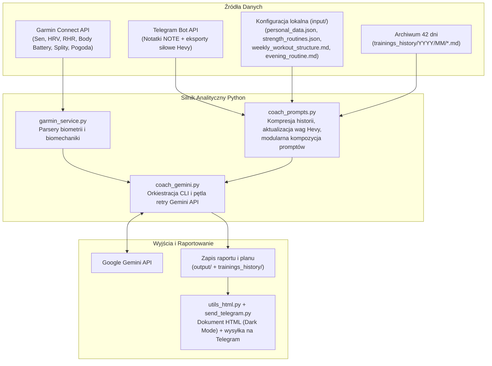

# Coach Gemini AI – Autonomous Garmin & Hevy Running Assistant

System autonomicznego trenera biegowego i fizjologa sportu łączący telemetrię z **Garmin Connect**, raporty siłowe z **Hevy (przez Telegram Bot API)** oraz modele **Google Gemini** w zautomatyzowanym potoku CI/CD (**GitHub Actions**).

---

## Kluczowe Rozwiązania Inżynieryjne (Engineering Highlights)

* **Hierarchiczna kompresja okna kontekstowego (42 dni historii w $\mathcal{O}(1)$)** – każdy raport dzienny w `trainings_history/` posiada ustandaryzowany 6-liniowy nagłówek metadanych. Podczas generowania planu tygodniowego 6-tygodniowa historia jest dzielona na trzy warstwy szczegółowości:
  1. *Tygodnie 1–4 (Makrocykl)*: zagregowany kilometraż oraz liczba jednostek biegowych i siłowych odczytywana bezpośrednio z nagłówków.
  2. *Tydzień 5 (Mezocykl)*: struktura jednostek, zaangażowane partie mięśniowe i decyzje adaptacyjne trenera.
  3. *Tydzień 6 (Mikrocykl)*: pełna synteza statusu autonomicznego układu nerwowego (ANS: HRV, RHR, Sleep Score, Body Battery), splity akcentów biegowych i ostrzeżenia o przeciążeniach.
* **Modularny silnik promptów oparty o kontrakty XML** – dynamiczna kompozycja szablonów (`daily_base.md` + dedykowane moduły `audit_run.md`, `audit_gym.md`, `audit_swim.md`, `audit_other.md`, `audit_rest.md` + `daily_closing.md`) dobierana w czasie wykonania na podstawie wykrytych aktywności dnia, redukująca zużycie tokenów o ~45%.
* **Dwukierunkowa integracja z Telegramem i parser Hevy z ochroną kanoniczności bazy** – odczyt surowych eksportów treningowych z aplikacji Hevy oraz notatek biegacza (`NOTE`) z czatu Telegrama. System automatycznie aktualizuje ciężary robocze i powtórzenia (`last_sets`) w `input/strength_routines.json`, odrzucając ćwiczenia doraźne spoza zdefiniowanego planu (ochrona bazy przed zanieczyszczeniem).
* **Odporność na blokady Cloud IP (HTTP 429 Rate Limit) w CI/CD** – obsługa magazynu sesji OAuth (`~/.garminconnect`) wstrzykiwanego z sekretu `GARMIN_TOKENS_BASE64` oraz pętla ponawiania zapytań (retry loop) do API Gemini.
* **Własny generator raportów HTML (Dark Mode)** – lekki konwerter Markdown $\rightarrow$ HTML (`utils_html.py`) i klient `multipart/form-data` (`send_telegram.py`) napisane wyłącznie w oparciu o bibliotekę standardową Pythona (`urllib`, `re`, `html`), generujące responsywne raporty mobilne z dynamicznym streszczeniem w podpisie wiadomości.

---

## Architektura i Przepływ Danych



---

## Szybki Start (Instalacja)

```bash
python3 -m venv .venv
source .venv/bin/activate
pip install -r requirements.txt
```

---

## Konfiguracja

### 1. Zmienne środowiskowe (`.env`)

Utwórz plik `.env` w katalogu głównym na podstawie wzorca `.env.example`:

```env
# Klucz i model Google Gemini
GEMINI_API_KEY="twój_klucz_gemini_api"
GEMINI_MODEL="gemini-3.8-flash"

# Dane logowania Garmin Connect
GARMIN_EMAIL="twoj_email@example.com"
GARMIN_PASSWORD="twoje_haslo"

# Opcjonalny token sesji OAuth w base64 (zalecany w GitHub Actions, aby uniknąć błędu HTTP 429)
# Wygenerowanie: base64 -w 0 ~/.garminconnect/garmin_tokens.json
# GARMIN_TOKENS_BASE64="ey..."

# Konfiguracja powiadomień Telegram
TELEGRAM_BOT_TOKEN="twój_token_z_botfather"
TELEGRAM_CHAT_ID="twój_chat_id"
```

### 2. Profil zawodnika (`input/personal_data.json`)

Zwięzła struktura JSON zoptymalizowana pod kątem minimalizacji zużycia tokenów:

```json
{
    "phase": "Race Week A",
    "primary_goal": {
        "target": "5km < 20:00",
        "date": "2026-10-24"
    },
    "secondary_goal": {
        "target": "800m < 2:17",
        "date": null
    },
    "last_event": {
        "type": "maraton",
        "time": "4:13:52",
        "date": "2026-09-27"
    },
    "height": "185 cm",
    "weight": "78 kg",
    "lthr": "182",
    "hr_zones": {
        "z1": "<123",
        "z2": "123-148",
        "z3": "149-162",
        "z4": "163-181",
        "z5": ">182"
    },
    "pace_zones": {
        "z1": ">6:15",
        "z2": "5:30-6:15",
        "z3": "4:45-5:30",
        "z4": "4:10-4:45",
        "z5": "<4:10"
    },
    "personal_records": {
        "400m": "0:59 (2026-05)",
        "800m": "2:17 (2023-06)",
        "5km": "20:47 (2024-11)",
        "10km": "45:12 (2026-09)",
        "polmaraton": "1:40:55 (2025-04)",
        "maraton": "4:13:52 (2026-09)"
    },
    "additional_notes": [
        "Licznik kroków dziennych około 10000 jest dla tego zawodnika normą i nie stanowi negatywnego obciążenia regeneracyjnego."
    ]
}
```

---

## Tryby Uruchomienia (Modes)

Skrypt `coach_gemini.py` przyjmuje pozycyjny argument określający tryb pracy:

| Tryb | Opis działania |
| :--- | :--- |
| **`daily`** *(domyślny)* | **Wieczorny audyt dnia i adaptacja na jutro**:<br>• Audyt wykonanego treningu (splity kilometrowe, GAP, dryf tętna Pa:Hr, kadencja, GCT, oscylacja pionowa, moc biegowa, warunki pogodowe, tonaż z siłowni Hevy).<br>• Diagnoza układu autonomicznego (HRV i RHR względem bazy 7-dniowej, architektura snu, Sleep Stress, drenaż Body Battery).<br>• Wytyczne regeneracyjne (modyfikacja rutyny wieczornej `input/evening_routine.md`, strategia substratowa).<br>• Decyzja adaptacyjna na kolejny dzień (`PEŁNA EGZEKUCJA PLANU`, `KOREKTA TAKTYCZNA`, `REDUKCJA AWARYJNA`) i zapis do `output/last_daily_report.md` oraz `trainings_history/YYYY/MM/YYYY-MM-DD.md`. |
| **`plan`** | **Programowanie pełnego mikrocyklu tygodniowego**:<br>• Projektuje 7-dniowy plan treningowy od poniedziałku do niedzieli na podstawie preferencji z `input/weekly_workout_structure.md` (dni z pustym polem po dwukropku są autonomicznie dopełniane przez model pod fazę mezocyklu i dystans docelowy).<br>• Wykorzystuje profil z `input/personal_data.json`, ciężary robocze z `input/strength_routines.json` oraz 42-dniową historię treningową.<br>• Zapisuje plan do `output/weekly_plan.md` i wysyła raport HTML na Telegram. |

---

## Protokół Komunikacji przez Telegram (Zawodnik $\rightarrow$ Trener)

System automatycznie klasyfikuje wiadomości wysłane do bota na podstawie **pierwszej niepustej linii tekstu**:

### 1. Raport z treningu siłowego (Hevy)
* Pierwsza linia zawiera nazwę rutyny: `fbw A` lub `fbw B` (lub `fbw_a` / `fbw_b`).
* Kolejne linie to skopiowany eksport z aplikacji Hevy. Skrypt parsuje wykonane serie i automatycznie aktualizuje ciężary robocze w `input/strength_routines.json`.

```text
fbw A
Thursday, Oct 22, 2026 at 5:15pm

Bench Press (Barbell)
Set 1: 75 kg x 6
Set 2: 75 kg x 5
Set 3: 75 kg x 5

Drop jump
Set 1: 6 reps
Set 2: 6 reps
Set 3: 6 reps
```

### 2. Notatka biegacza (`NOTE`)
* Pierwsza linia zawiera słowo kluczowe `NOTE` (automatycznie usuwane przed wstrzyknięciem do promptu).
* Wiadomości bez nagłówka `NOTE` i bez nazwy rutyny siłowej są traktowane tolerancyjnie jako ogólna uwaga biegacza.
* Po pomyślnym uruchomieniu identyfikator `update_id` zapisywany jest w `input/telegram_state.json`, co zapobiega dublowaniu wiadomości.

---

## Flagi CLI i Przykłady Użycia

| Flaga | Opis |
| :--- | :--- |
| **`--debug`** | Izoluje wykonanie w katalogu `debug/` (zapisuje pełny prompt do `debug/debug_log.md`, nie nadpisuje plików produkcyjnych ani stanu Telegrama). |
| **`--send_debug`** | Włącza tryb `--debug` oraz wysyła wygenerowany raport testowy na Telegram. |
| **`--date YYYY-MM-DD`** | Uruchamia audyt lub planowanie dla wskazanej daty historycznej (np. `--date 2026-10-18`). |

```bash
# Wieczorny audyt dzisiejszego dnia
python coach_gemini.py daily

# Wygenerowanie nowego planu tygodniowego
python coach_gemini.py plan

# Testowe uruchomienie w piaskownicy debug/ z podglądem wygenerowanego promptu
python coach_gemini.py daily --debug

# Przeliczenie raportu dla konkretnej daty
python coach_gemini.py daily --date 2026-10-20
```

---

## Struktura Projektu

```text
├── coach_gemini.py                 # Punkt wejścia CLI, klient Gemini API z pętlą retry, orkiestracja trybów
├── garmin_service.py               # Klient Garmin Connect, obsługa sesji OAuth, parsery biometrii i splitów
├── coach_prompts.py                # Silnik promptów, kompresja 42 dni historii, parser Hevy i archiwizacja
├── send_telegram.py                # Klient Telegram Bot API (wysyłka dokumentów HTML, odbiór notatek)
├── utils_html.py                   # Konwerter raportów Markdown na responsywny dokument HTML (Dark Mode)
├── requirements.txt                # Zależności projektu
├── .env.example                    # Szablon zmiennych środowiskowych
├── .github/workflows/
│   └── gemini_coach.yml            # Workflow GitHub Actions (automatyzacja daily/plan + cache OAuth)
├── input/
│   ├── personal_data.json          # Profil zawodnika, cele, strefy HR/tempa i rekordy życiowe
│   ├── strength_routines.json      # Kanoniczna baza ćwiczeń siłowych i ostatnich ciężarów roboczych
│   ├── weekly_workout_structure.md # Preferowany rozkład jednostek w dniach tygodnia (dla trybu 'plan')
│   ├── evening_routine.md          # Bazowa rutyna wieczorna (mobilność, SMR, wyciszenie autonomiczne)
│   └── telegram_state.json         # Stan ostatnio przetworzonej wiadomości z Telegrama
├── output/
│   ├── weekly_plan.md              # Aktualny plan tygodniowy (Markdown + wygenerowany podgląd HTML)
│   └── last_daily_report.md        # Ostatni wygenerowany raport dzienny (Markdown + podgląd HTML)
├── prompts/
│   ├── daily_base.md               # Bazowy szablon roli fizjologa i danych wejściowych dla trybu 'daily'
│   ├── audit_*.md                  # Modularne szablony audytu (run, gym, swim, other, rest)
│   ├── daily_closing.md            # Szablon oceny gotowości i dyrektywy na kolejny dzień
│   └── weekly_plan.md              # Szablon architektury programowania mikrocyklu tygodniowego
└── trainings_history/              # Archiwum raportów dziennych (YYYY/MM/YYYY-MM-DD.md)
```
